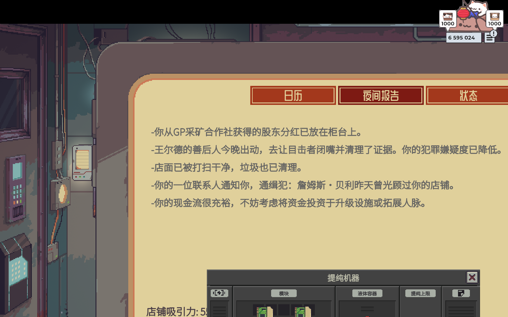
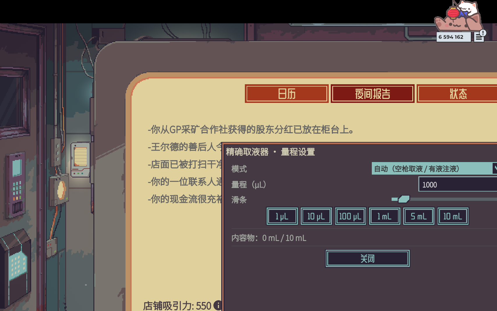

# Precision Lab · 精密实验室

《深空当铺：可能是偷的》/ *Probably Stolen* 0.46D 的本地 mod：**精确取液器** + **提纯机器**。



> 适配游戏版本：**0.46D**（Unity 2021.3.45f2，Mono）。纯本地 mod，不修改游戏文件，不依赖第三方 mod 框架。

---

## 新增内容 / What's inside

### 1. 精确取液器 · Precision Liquid Extractor

移液枪式定量转移液体，精确到 **1 µL**（`um` / `µL` 同一单位，1 mL = 1000 µL）。

- 容量 10 mL；**精确或拒绝**：可转移量不足设定值时一滴不移，并在提示里说明原因；
- **双击**物品打开量程设置窗口：数值输入框 + 滑条 + 预设按钮（1/10/100 µL、1/5/10 mL）；
- **改动即时生效，无需点「应用」**；关闭窗口不会丢失设置；量程保存在物品上（每把可不同）；
- **方向模式**（下拉框，保存在物品上）：
  - 自动：空枪 → 取液；有液 → 注液
  - 强制取液：总是从目标容器取液（例：枪里 980 µL，再取 20 µL 补满 1 mL）
  - 强制注液：总是注入
- 目标必须是已拥有的液体容器；酒类容器（有独立品质系统）拒绝；
- 取液器拒绝被其他容器偷偷「倒液」，保证计量语义。



### 2. 提纯机器 · Purification Machine

夜间运转（或用涡轮增压器追加一次周期），去除物理 / 化学 / 生物污染物，保留有效成分。

- 去除范围：物理污染物、微塑料、碎屑、矿物 / 化学污染物、**重金属** / 微生物、有机废物、植物残渣；
  工具提示按 **物理 / 化学 / 重金属 / 生物** 四类分别显示毫升数；
- 两套自动记账：只含水和污染物的容器 → **净水**（污染物转化为清水，总体积不变）；
  含贵重液体的容器 → **浓缩**（污染物销毁，有效成分保留）；
- 模块效果：**性能 = 每周期处理量**、**效率 = 耗电**、**质量 = 提纯上限**；
- 机器窗口一行五格：电源｜模块｜液体容器｜**提纯上限**｜**说明便签**；
  提纯上限实时显示 `99.00% (+0.00%)`，插质量模块即时上升（如 2 个质量模块 → `99.15% (+0.15%)`）；
- 到手的机器右侧便签槽自带 **「提纯机器说明」** 文档（仿原版蒸发器说明的版式），写明模块影响与运行方式；
- 每周期耗电 6，需要电池槽供电；液体容器放入槽位后机器夜间运转。

## 获取方式 / How to obtain

1. **黑网升级（Wild Network）**：游戏内手机 → 黑网 →「精密实验室」标签页购买两台机器的解锁升级；
   解锁后第一台直接送达店内库存（免费）。
2. **杰克逊博士（Dr. Jackson）**：解锁提纯机器后，他的柜台上会开始供货 —
   普通来访 +1 台、特殊库存夜晚 +2 台，可重复购买。
3. **战利品**：低概率出现在医疗 / 废品战利品池中。

---

## 安装 / Install

需要游戏目录（包含 `Probably Stolen.exe`）下的 `Mods` 文件夹。

**方式 A：脚本（推荐）**

```powershell
# 仅安装
powershell -ExecutionPolicy Bypass -File tools\install-mod.ps1 -GameDir "<游戏安装目录>"

# 安装并预置启用/信任（游戏需先关闭；会备份 SaveFile.es3）
powershell -ExecutionPolicy Bypass -File tools\install-mod.ps1 -GameDir "<游戏安装目录>" -Enable
```

**方式 B：手动**

把 `dist\PrecisionLab` 整个文件夹复制到 `<游戏安装目录>\Mods\PrecisionLab`，启动游戏后在 Mods 菜单启用并信任即可。

> 首次加载时游戏会要求确认 mod（Mods 菜单 / 信任弹窗）；本 mod 的 manifest 无任何特殊能力声明（`<Capabilities/>` 为空），扫描应直接通过。

---

## 从源码构建 / Build from source

需要 .NET SDK（`netstandard2.1` 目标）+ 游戏自带的 Managed 程序集：

```powershell
cd src\PrecisionLab
dotnet build -c Release -p:GameDir="<游戏安装目录>"
# 或先设置环境变量 GameDir / PROBABLY_STOLEN_DIR
```

构建产物直接输出到 `dist\PrecisionLab\PrecisionLab.dll`（与 manifest 同级）。

## 仓库结构

```
dist/PrecisionLab/        可直接安装的 mod 包（manifest、DLL、本地化、贴图、战利品表、中文说明）
src/PrecisionLab/         C# 源码（IMod 入口、物品工厂、液体工具、UI、Harmony 补丁、自检）
docs/                     设计与逆向笔记（mod 框架、机器 API、液体 API、验证流程）
docs/images/              截图与贴图预览
tools/install-mod.ps1     安装/卸载脚本
tools/seed-trust.ps1      预置启用列表 + 信任指纹（可选）
tools/assets/             贴图生成/导入脚本（程序生成提纯机器贴图；取液器贴图来自作者像素画）
```

## 说明 / Notes

- 本 mod 不包含、不复制任何游戏原版代码或资源；物品贴图（取液器像素画）为 mod 作者自制。仓库中的文档记录了通过反编译进行的 API 研究，仅用于兼容性开发。
- 游戏内 slug/ID：`precision_lab`；物品 ID：`precision_liquid_extractor`、`precision_purifier`。
- 自检：加载存档后游戏日志会打印 `[PrecisionLab] SELFTEST ...`，可用于确认安装成功。
- 与 *Item Details* 等创意工坊 mod 无依赖关系。

## 许可 / License

见仓库内 LICENSE 文件。
