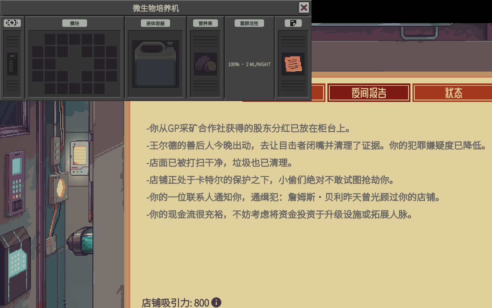

# Precision Lab · 精密实验室

《深空当铺：可能是偷的》/ *Probably Stolen* **0.46D** 的本地 mod：**精确取液器** · **提纯机器** · **微生物培养机** · **淀粉水解反应**。



> 适配游戏版本：**0.46D**（Unity 2021.3.45f2，Mono）。纯本地 mod，不修改游戏文件，不依赖第三方 mod 框架。
> Mod ID：`precision_lab` · 当前版本：**1.1.0**

---

## 内容 / What's inside

### 1. 精确取液器 · Precision Liquid Extractor

移液枪式定量转移液体，精确到 **1 µL**（1 mL = 1000 µL）。

- 容量 10 mL；**双击**打开量程窗口：数值输入框 + 滑条 + 预设按钮（1/10/100 µL、1/5/10 mL）；
- **改动即时生效，无需点「应用」**；关闭窗口不丢设置；量程保存在物品上（每把可不同）；
- **方向模式**：自动（空枪取液 / 有液注液）｜强制取液｜强制注液——
  例：枪里 980 µL 时切到「强制取液」再取 20 µL 即可补满 1 mL；
- **精确或拒绝**：可转移量不足设定值时整体拒绝、一滴不移。

### 2. 提纯机器 · Purification Machine

夜间去除液体中的物理 / 化学 / 生物污染物，保留有效成分。

- 工具提示分四类显示：**物理 / 化学 / 重金属 / 生物**；
- 两套自动记账：只含水和污染物 → **净水**（总体积不变）；含贵重液体 → **浓缩**（污染物销毁）；
- 机器窗口单行五格：电源｜模块｜容器｜**提纯上限**｜**便签**；提纯上限面板实时显示 `99.00% (+0.00%)`，
  质量模块提高上限（2 个质量模块 → `99.15% (+0.15%)`）；
- 右侧便签槽自带「提纯机器说明」文档（仿原版蒸发器说明版式）；
- 模块效果：性能→每周期处理量，效率→耗电，质量→提纯上限。

### 3. 微生物培养机 · Microbial Cultivator

培养“吃糖”微生物：把含糖液体容器放进液体槽，把 **营养果（小 / 正常 / 大 / 巨型）**放进营养果槽。

- 每夜机器**压榨一个营养果成汁水**喂养菌群（+15 / +25 / +40 / +60 活性），然后分解糖：
  约 20% 的糖变成有机废物（质量模块可降到约 5%），其余被微生物消耗掉，总体积下降；
- **低糖分 → 休眠**：没有糖时菌群活性每夜下降并进入休眠（面板显示「休眠 · 需要营养果」，
  不再分解）；补充营养果 + 糖后恢复；
- 六面板单行窗口：电源｜模块｜容器｜**营养果**｜**菌群活性**｜便签；便签槽自带「微生物培养机说明」；
- 模块效果：性能→每夜糖分解量，质量→残留有机废物，效率→耗电；耗电 8/周期。

### 4. 淀粉水解 · Starch hydrolysis（新增化学反应）

```
淀粉 --(酸催化, 40–60 °C)--> 糖
```

- 含 **淀粉 + 酸** 的液体容器放在 **加热板** 上，把目标温度调到 40–60 °C 并保温；
- 每秒把一部分淀粉转化为等量糖，**酸是催化剂、不消耗**，总体积不变；
- 加热板需要至少 2 个化学模块才能自由调节到低温区间（0/1 个模块固定 99/160 °C）。

---

## 获取方式 / How to obtain

1. **黑网升级（Wild Network，游戏内手机）→「精密实验室」页签**：
   - 精确取液器 1200 信用点 · 微生物培养机 1800 信用点 · 提纯机器 2400 信用点，购买后送达店内库存；
2. **杰克逊博士（Dr. Jackson）**：解锁对应机器后，他每次来访柜台 +1 台（“特殊库存”夜 +2 台），可重复购买；
3. **退休化学家**（供应商客人）：解锁取液器后，如果你当前**不拥有**取液器（丢了），他柜台会卖一把替补充，最多一把；
4. **战利品**：医疗 / 废品战利品池低概率出现；
5. **调试**（仅测试）：放空 `dev.txt` 启动，F9 调试面板 → Spawn 有三个生成按钮。

---

## 安装 / Install

需要游戏目录（包含 `Probably Stolen.exe`）下的 `Mods` 文件夹。

**方式 A：脚本（推荐）**

```powershell
# 仅安装
powershell -ExecutionPolicy Bypass -File tools\install-mod.ps1 -GameDir "<游戏安装目录>"

# 安装并预置启用/信任（游戏需先关闭；会备份 SaveFile.es3）
powershell -ExecutionPolicy Bypass -File tools\install-mod.ps1 -GameDir "<游戏安装目录>" -Enable
```

**方式 B：手动**

把 `dist\PrecisionLab` 整个文件夹复制到 `<游戏安装目录>\Mods\PrecisionLab`，启动游戏后在 Mods 菜单启用并信任。

> 首次加载时游戏会要求确认 mod；本 mod 的 manifest 无特殊能力声明（`<Capabilities/>` 为空），扫描应直接通过。
> 数据文件更新（贴图/本地化/战利品表）不需要重新信任；只有 `manifest.xml` 或 DLL 变化才需要重新确认。

---

## 从源码构建 / Build from source

需要 .NET SDK（`netstandard2.1` 目标）+ 游戏自带的 Managed 程序集：

```powershell
cd src\PrecisionLab
dotnet build -c Release -p:GameDir="<游戏安装目录>"
# 或先设置环境变量 GameDir / PROBABLY_STOLEN_DIR
```

构建产物直接输出到 `dist\PrecisionLab\PrecisionLab.dll`（与 manifest 同级）。

## 仓库结构

```
dist/PrecisionLab/        可直接安装的 mod 包（manifest、DLL、本地化、贴图、战利品表、说明）
src/PrecisionLab/         C# 源码（IMod 入口、物品工厂、液体/化学反应、UI、Harmony 补丁、自检）
docs/                     设计与逆向笔记（mod 框架、机器 API、液体 API、验证流程）
docs/images/              截图与贴图预览
tools/install-mod.ps1     安装/卸载脚本
tools/seed-trust.ps1      预置启用列表 + 信任指纹（可选）
tools/assets/             贴图生成脚本（程序生成三台机器的像素贴图）
```

## 实现要点 / Implementation notes

- 全部通过游戏自带 mod 框架实现：`IMod` / `ModHook` / `ModItemDirectory` / `ModHelper`；
- 化学反应：Harmony postfix 挂到 `ChemicalHelper.HandleTemperatureReaction`，按 `CONTAINER_TEMP_TAG`
  与液体 tag 每秒结算（淀粉+酸，40–60 °C）；
- 培养机：夜间 `onCycleEndSlotItemFunc` 消耗营养果、结算糖→有机废物；活性 tag 驱动处理量，低糖休眠；
- 机器便签：`DirectoryMaster.Item` 后置补丁在物品创建完成后再插入说明纸（工厂内插入会被清子物品）；
- 取液器/机器窗口：游戏自带 CustomUI（META prefab）与 Machinery 控件，双击 Harmony 前缀接管；
- 供货：杰克逊博士两个库存方法 Harmony postfix；退休化学家 `CreateRetiredChemist` 的 `endAction` 包装。

## 说明 / Notes

- 本 mod 不包含、不复制任何游戏原版代码或资源；三台机器的像素贴图由 mod 程序生成，取液器像素画来自作者。
  仓库文档记录了通过反编译进行的 API 研究，仅用于兼容性开发。
- 与 *Item Details* 等创意工坊 mod 无依赖关系。
- 自检：加载存档后游戏日志会打印 `[PrecisionLab] SELFTEST ...`，可用于确认安装成功。

## 许可 / License

MIT — 见 [LICENSE](LICENSE)。
